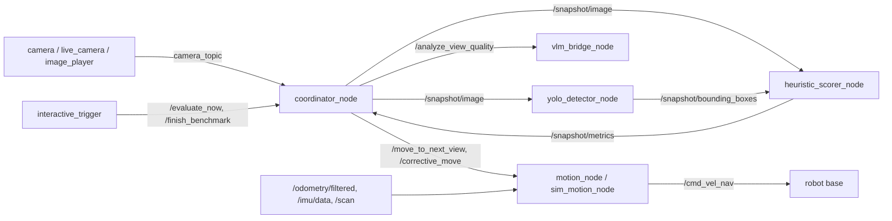

# ROS 2 Active Perception

Scores how good the camera's view of a target object is and moves a BeetleBot (Lyra)
skid-steer robot to fix the weakest factor, asking a Gemini VLM only once a view passes local checks.


<p align="center">
  <a href="media/Active_Perception.mp4"></a>
</p>
<p align="center"><em>Real hardware: the BeetleBot moves a little closer to a plastic bottle to get
a better view (2x speed; click for the full video).</em></p>

## Overview

A robot told to look at an object often gets a useless frame: blurred by its own motion, too
dark, cut off, too far away or blocked. Sending every frame to a VLM is slow and costly, and a
VLM score doesn't say how to move. Here each snapshot first goes through cheap local checks
(YOLO detection, sharpness, exposure, framing, detector confidence). Every check maps to one
corrective move, and the robot makes the move for the weakest one. Gemini is only asked about
occlusion and framing once a view passes all local checks. After a fixed number of attempts the
robot undoes its moves and returns to the best view it found.

## Key Features

- Four local metrics on the target's bounding box, each scored in [0, 1] with 0.5 at the pass
  threshold so they can be compared: sharpness (Laplacian variance), exposure (mean HSV value,
  too dark and too bright), framing (centre offset, size, cut off at the border) and visibility
  (YOLO confidence).
- Weakest-factor decision layer: blur → retake, exposure or occlusion → orbit 30°, off-centre →
  rotate, too small → approach 0.15 m, too big → back off 0.15 m. Capped at `max_attempts`
  views, then it retraces the moves back to the best view.
- Gemini (structured JSON output) is called only after the local check passes.
- Runs without a robot: a no-ROS script for images or a webcam, an image-player camera node and a
  simulated motion node. 47 pytest tests cover the metrics and the decision logic.

## System Architecture



| Node | Subscribes | Publishes | Services / Actions | Purpose |
|---|---|---|---|---|
| `coordinator_node` | `camera_topic` (`CompressedImage` or `Image`), `/odometry/filtered`, `/snapshot/metrics` | `/snapshot/image` | servers `/evaluate_now`, `/finish_benchmark`; clients `/analyze_view_quality`, `/move_to_next_view`, `/corrective_move` | Freezes snapshots, runs the local check and decision layer, logs runs |
| `yolo_detector_node` | `/snapshot/image` | `/snapshot/bounding_boxes` (`vision_msgs/Detection2DArray`) | none | YOLOv8n detection of `target_object` |
| `heuristic_scorer_node` | `/snapshot/image` + `/snapshot/bounding_boxes` (exact time sync) | `/snapshot/metrics` (`HeuristicMetrics`) | none | Sharpness, illumination, coverage, confidence on the best box |
| `vlm_bridge_node` | none | none | server `/analyze_view_quality` (`AnalyzeQuality`) | Gemini occlusion and framing scores (0-100) |
| `motion_node` | `/odometry/filtered`, `/imu/data`, `/scan` | `/cmd_vel_nav` (`Twist`) | servers `/move_to_next_view` (`Trigger`), `/corrective_move` (`CorrectiveMove`); clients `/lyra/arm`, `/lyra/disarm` | Orbit, rotate, drive forward/back with IMU turns and lidar stop |
| `sim_motion_node` | none | none | servers `/move_to_next_view`, `/corrective_move` | Accepts and logs moves (no robot) |
| `interactive_trigger` | none | none | clients `/evaluate_now`, `/finish_benchmark` | Keyboard: ENTER = evaluate, `exit` = scoreboard |
| `live_camera_node` | none | `camera_topic` | none | Webcam as the camera |
| `image_player_node` | `/snapshot/image` | `camera_topic` | none | Image folder as the camera, next image per snapshot |

No ROS actions are used. `camera_topic` defaults to `/pi_camera/image_raw/compressed`. Custom
interfaces are in `active_perception_interfaces`: `msg/HeuristicMetrics`,
`srv/AnalyzeQuality`, `srv/CorrectiveMove`.

## Requirements

- Ubuntu 24.04, ROS 2 Jazzy, Python 3.12 (no simulator needed)
- System packages (installed by rosdep): `ros-jazzy-vision-msgs`, `ros-jazzy-message-filters`,
  `python3-opencv`, `python3-numpy`
- Python packages: `ultralytics`, `google-genai`
- Hardware (optional): BeetleBot / Lyra base with Pi camera, IMU and 2D lidar; otherwise a
  webcam or a folder of images
- API key: `GEMINI_API_KEY` (see `.env.example`)

## Installation

The repository is itself the colcon workspace (`src/active_perception`,
`src/active_perception_interfaces`).

```bash
source /opt/ros/jazzy/setup.bash
git clone https://github.com/dinesh1160/ros2_active_perception.git ~/ros2_active_perception
cd ~/ros2_active_perception

sudo rosdep init 2>/dev/null; rosdep update
rosdep install --from-paths src --ignore-src -y

python3 -m venv --system-site-packages .venv
touch .venv/COLCON_IGNORE
source .venv/bin/activate
pip install ultralytics google-genai

colcon build --symlink-install
source install/setup.bash
cp .env.example .env   # then add your GEMINI_API_KEY
```

`yolov8n.pt` is downloaded by ultralytics on first run.

## Usage

Run from the repository root so `.env`, `yolov8n.pt` and `runs/` resolve. In a second
terminal, `ros2 run active_perception interactive_trigger` (ENTER = evaluate, `exit` = results).

```bash
# Robot (after the robot's bringup is running)
ros2 launch active_perception active_perception.launch.py target_object:=bottle auto_correct:=true

# No robot: webcam, or a folder of images, with simulated moves
ros2 launch active_perception active_perception.launch.py use_webcam:=true sim_motion:=true auto_correct:=true target_object:=cup
ros2 launch active_perception active_perception.launch.py use_images:=true image_dir:=eval/base sim_motion:=true auto_correct:=true target_object:=bottle

# No ROS at all
python scripts/score_images.py eval/base/*.jpg --target bottle [--vlm]
```

`auto_correct:=false` (default) keeps the simpler mode: a fixed 30° orbit step before every
snapshot after the first. Each session is saved to `runs/run_<timestamp>/` (frames, annotated
frames, `results.json`, `summary.txt`).

## Evaluation

The evaluation covers the local layer only (YOLO + metrics + decision layer, no Gemini calls). It
measures how each metric responds to controlled degradations and how often the expected
corrective move is chosen.

**Setup.** Two base views where the target is sharp, well lit and well framed: a 320×240 robot
snapshot (`bottle`) and a crop of the ultralytics `bus.jpg` sample (`person`). Each is degraded
one factor at a time at 4-5 strengths: Gaussian blur, motion blur, under- and over-exposure,
zoom out, zoom in, horizontal shift, occlusion. That gives 76 degraded images, plus 2 clean
ones and 2 real, hand-labelled robot snapshots. Generation is deterministic (occlusion
texture seed 0). A detection counts only if its IoU with the ground-truth box is ≥ 0.3.
Thresholds were fixed before the run. Machine: Intel i5-8250U, CPU only, YOLOv8n, ultralytics
8.4.183, torch 2.14.1.

**Reproduce:**

```bash
pip install ultralytics matplotlib && python eval/make_testset.py && python eval/run_eval.py
```

| Degradation | Cases | Flagged locally | Correct move | Target lost | Wrong object |
|---|---|---|---|---|---|
| Gaussian blur | 10 | 4 | 4/4 | 3 | 1 |
| Motion blur | 10 | 1 | 1/1 | 3 | 1 |
| Under-exposure | 10 | 4 | 3/4 | 1 | 0 |
| Over-exposure | 10 | 1 | 1/1 | 3 | 1 |
| Zoom out | 10 | 2 | 0/2 | 2 | 5 |
| Zoom in | 8 | 3 | 2/3 | 3 | 1 |
| Shift | 8 | 6 | 6/6 | 0 | 0 |
| Occlusion | 10 | 1 | 0/1 | 3 | 3 |
| **All** | **76** | **22** | **17/22 (77%)** | **18** | **12** |

- When the local check flagged a failure on the right object, the expected move was chosen
  17/22 times (77%). Over all 76 degraded images it was chosen 17 times (22%). 24 mild cases
  passed the local check, and detector failures account for most of the rest.
- Both real robot snapshots got the expected move (cut-off bottle → back off, distant bottle →
  approach).
- Weak spots measured: darkness also lowers sharpness (gain 0.15 picked retake over orbit);
  mean brightness missed a view with 60% of ROI pixels clipped (mean 212.5 < 235); YOLO
  confidence is a weak occlusion proxy (the bottle is lost from 50% coverage).

Per-case numbers and metric curves: [`eval/results/summary.md`](eval/results/summary.md),
[`eval/results/metric_response.png`](eval/results/metric_response.png).

## Tests

```bash
cd src/active_perception && python3 -m pytest test/test_view_quality.py test/test_decision.py
```

## Status and limitations

- On hardware: the snapshot pipeline (camera → YOLO → metrics → Gemini) and orbit motion.
- The `auto_correct` loop and `/corrective_move` were run end to end in ROS 2 with
  `image_player` and `sim_motion`, not yet on the robot.
- `target_object` defaults to `vase`; for the demo bottle use `target_object:=bottle` (YOLOv8n
  labels it `bottle`).
- `camera_hfov_deg` (62.2°) and `robot_rear_offset` (0.19 m) are defaults; set them for your
  hardware. Returning to the best view relies on odometry, so drift adds up.

## License

[Apache-2.0](LICENSE)
