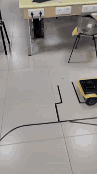
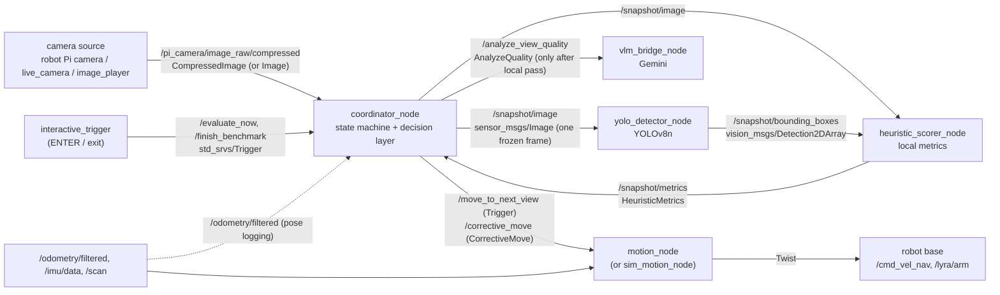
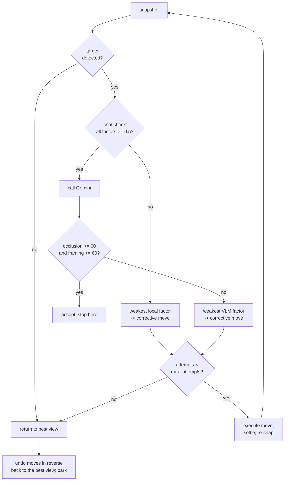
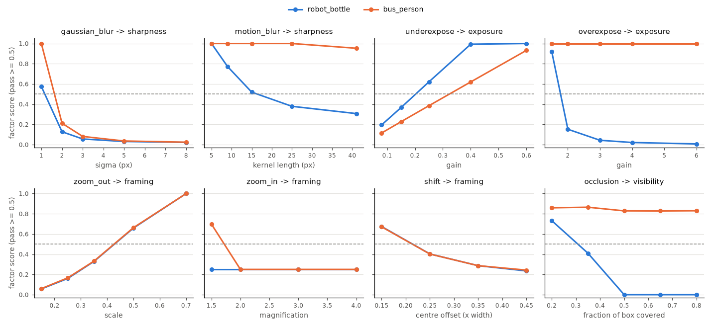

# Active Perception for a Ground Robot (ROS 2)

A ROS 2 (Jazzy) pipeline that lets a small ground robot judge whether its current camera view
of a target object is good enough. If it isn't, the robot moves to fix whatever is weakest.
Cheap local checks run on every frame: YOLO detection, sharpness, exposure, framing and a
detector-confidence proxy for occlusion. A vision-language model (Google Gemini) is only
asked about occlusion and framing once a view has passed every local check.

<p align="center">
  <a href="docs/media/Active_Perception.mp4"></a>
</p>

## Demo on hardware

| | |
|---|---|
| Video | [`docs/media/Active_Perception.mp4`](docs/media/Active_Perception.mp4): 18 s, handheld; the GIF above is a 2x-speed preview |
| Robot | BeetleBot ("Lyra") skid-steer base with a Pi camera, IMU and 2D lidar. The perception nodes run on a laptop |
| Target | A plastic water bottle on the lab floor |
| What it shows | The robot moving a little closer to the bottle to get a better view of it |

Three runs from the robot are logged in `runs/` (git-ignored):

| Run | Outcome |
|---|---|
| 2026-10-12 16:19 | Scored: sharpness 737.3, illumination 143.5, VLM occlusion 100 / framing 100, total 100.0 |
| 2026-10-12 16:27 | Passed the local check (sharpness 1109, illumination 150), then the Gemini call timed out |
| 2026-10-12 17:23 | Discarded: `No vase detected`. YOLO labels this bottle `bottle` (0.865), not `vase` (see [Known issues](#known-issues)) |

## The problem

A robot sent to "look at the vase" can end up with a useless image: blurred by its own motion,
too dark, half out of frame, too far away, or blocked by a chair. Sending every frame to a
VLM is slow (seconds per call) and costs money, and a VLM score alone doesn't tell the robot
*how* to move. This project splits the job in two:

1. **Local checks** (milliseconds, on the laptop) measure sharpness, exposure, framing and
   detector confidence. Each one maps to a specific corrective move.
2. **The VLM** is only consulted for views that already pass locally. It judges what the
   cheap metrics can't see well: real occlusion and whether the whole object is in frame.

## Architecture



The camera streams continuously, but the pipeline only ever processes **one frozen
snapshot** at a time. The coordinator publishes it on `/snapshot/image` with a unique
timestamp. YOLO copies that header, the heuristic scorer pairs image and detections with an
exact-time synchronizer, and the coordinator ignores any metrics whose stamp doesn't match the
snapshot it's waiting on. Every stage has a timeout, so a lost message can't wedge the state
machine.

### Nodes

| Executable | Node | Role |
|---|---|---|
| `coordinator` | `coordinator_node` | Freezes snapshots, runs the local check and the decision layer, calls the VLM and motion services, writes `runs/run_<timestamp>/` |
| `yolo_detector` | `yolo_detector_node` | YOLOv8n on each snapshot, restricted to `target_object`, confidence >= 0.25 |
| `heuristic_scorer` | `heuristic_scorer_node` | Takes the highest-confidence box and computes sharpness, illumination, coverage and confidence on it |
| `vlm_bridge` | `vlm_bridge_node` | Gemini with a structured-JSON schema: occlusion 0-100, framing 0-100, one-sentence reasoning |
| `motion` | `motion_node` | Orbit steps, in-place turns and straight drives. Turns are measured with the IMU gyro (skid-steer odometry over-reports rotation), with a lidar stop in front and behind, arm/disarm around every move, and zero velocity on any failure |
| `interactive_trigger` | `interactive_trigger` | Keyboard: ENTER = evaluate, `exit` = print the scoreboard |
| `live_camera` | `live_camera_node` | Webcam publisher for testing without the robot |
| `image_player` | `image_player_node` | Plays a folder of images as the camera, advancing one image per snapshot |
| `sim_motion` | `sim_motion_node` | Accepts every move and only logs it, so the corrective loop can run without a robot |

`scripts/beetlebot_check.py` is a calibration helper for the robot. It checks topic rates and
the lidar sectors, and measures gyro sign/scale and odometry scale, then prints the launch
arguments to use.

### Custom interfaces (`active_perception_interfaces`)

```text
# msg/HeuristicMetrics.msg            published on /snapshot/metrics
std_msgs/Header header                # copied from the snapshot, used for matching
bool    target_detected
float32 sharpness_score               # variance of Laplacian on the target ROI
float32 illumination_score            # mean HSV value (0-255) on the target ROI
float32 bbox_area_ratio               # bbox area / image area
float32 bbox_x_min, bbox_y_min, bbox_x_max, bbox_y_max   # pixels, clamped to the image
float32 detection_confidence          # YOLO confidence (local occlusion proxy)

# srv/AnalyzeQuality.srv              /analyze_view_quality (vlm_bridge_node)
sensor_msgs/Image image
string  target_object
---
bool    success
float32 occlusion_score               # 0-100, 100 = fully visible
float32 framing_score                 # 0-100, 100 = whole object well framed
string  reasoning

# srv/CorrectiveMove.srv              /corrective_move (motion_node)
string  action                        # 'orbit' | 'rotate' | 'translate'
float32 value                         # orbit/rotate: degrees (+ = CCW); translate: metres (+ = forward)
float32 radius                        # orbit only: current distance to the target (0 = orbit_radius)
---
bool    success
string  message
```

(Each `float32` is its own line in the actual `.msg` file; it's condensed here.)

## View-quality metrics

All metrics are computed on the target's bounding box (the ROI), not on the whole frame. Each
factor maps to a **score in [0, 1] where 0.5 is exactly the pass threshold**, so factors with
different units can be compared to find the weakest one
([`view_quality.py`](src/active_perception/active_perception/view_quality.py)).

| Factor | What is measured | Score | Default threshold | Where |
|---|---|---|---|---|
| **Sharpness** | Variance of the Laplacian of the grayscale ROI | `0.5 * value / min` | `min_sharpness` 50 | local |
| **Exposure** (lighting) | Mean HSV *value* channel of the ROI (0-255) | two-sided: `min(0.5*v/min, 0.5*(255-v)/(255-max))` | `min_illumination` 30, `max_illumination` 235 | local |
| **Framing** | Box centre offset (fraction of width), box area / image area, contact with the image border | lowest of three components: off-centre, too small, too big. A box cut off at the top/bottom (or on both sides) scores 0.25 as *too big*; one cut off on a single side scores 0.25 as *off-centre* | `max_center_offset` 0.2, `min_coverage` 0.03, `max_coverage` 0.5 | local |
| **Visibility** (occlusion proxy) | YOLO confidence of the target box | `0.5 * conf / min` | `min_confidence` 0.5 | local |
| **Occlusion** | Gemini: "is the target blocked by anything?" 0-100 | `0.5 * score / min` | `vlm_min_occlusion` 60 | VLM |
| **Framing (VLM)** | Gemini: "is the entire target in the frame?" 0-100 | `0.5 * score / min` | `vlm_min_framing` 60 | VLM |

Scores are capped at 1.0, so passing factors don't compete. Views the VLM has scored are
ranked by `0.4 * occlusion + 0.4 * framing + 0.2 * coverage_score`, where
`coverage_score = min(bbox_area_ratio / 0.25, 1) * 100`. This total picks the best view.

## Decision layer: weakest-factor corrective moves

Enabled with `auto_correct:=true`. Each ENTER starts an **episode**:



| Weakest factor | Diagnosis | Move | Size |
|---|---|---|---|
| sharpness | motion blur / not settled | `retake`: hold still `retake_settle_sec` (2 s), snap again | none |
| exposure | too dark or too bright | `orbit`: view the target from another side relative to the light | `orbit_step_deg` (30°) around the target at the current range |
| visibility | low detector confidence | `orbit` around the obstruction | 30° |
| framing: off-centre | target left/right of centre, or cut off on one side | `rotate` towards it | `offset × camera_hfov_deg` (62.2° default) |
| framing: too small | coverage < 3% | `approach` | `translate_step_m` (0.15 m), never closer than `min_range_m` (0.3 m) |
| framing: too big | coverage > 50%, or cut off at the top/bottom | `back_off` (reverse) | 0.15 m, with a rear lidar check |
| VLM occlusion | something blocks the target | `orbit` | 30° |
| VLM framing | target not fully in frame | lowest local framing component (rotate / approach / back off), even if it passed | as above |

Details:

- **Weakest factor** = the failing factor with the lowest score. Only one move is made per
  view, then the robot settles and re-checks.
- **Attempt limit**: an episode takes at most `max_attempts` views (default 5).
- **Return to best view**: when the limit is reached, the target is lost, the VLM fails, or an
  approach would go below `min_range_m`, the coordinator picks the best view of the episode:
  VLM-scored views by total score, then views that failed locally by their lowest factor score,
  then views with no detection; ties go to the earliest view. It then **undoes the moves made
  since that view, in reverse** (orbit ↔ opposite orbit at the same radius, rotate ↔ opposite
  rotate, approach ↔ back off, retakes skipped). The robot parks where the best image was
  taken. This relies on odometry/IMU being accurate over a few moves; there is no global
  localisation.
- **Range tracking**: the episode tracks the estimated distance to the target (starts at
  `orbit_radius`, changes with approach/back off), so orbit steps are made at the right radius.
- If a move fails (obstacle, timeout), the episode is **aborted without retracing**, because
  the robot's position is no longer known.

With `auto_correct:=false` (the default) the original fixed survey runs
instead. Every ENTER after the first makes one 30° orbit step. The local gate is only
sharpness ≥ 50 and illumination ≥ 30, every passing frame goes to Gemini, and `exit` reports
the best-scoring frame. That frame is copied to `best_view.jpg`, but the robot does not drive
back to it.

### When the VLM is called

Only after a snapshot (1) contains the target according to YOLO and (2) passes every local
check: sharpness and minimum illumination in fixed-orbit mode, and all four local factors in
`auto_correct` mode. Views that fail locally never reach Gemini.

## Install

Tested setup: Ubuntu 24.04, ROS 2 Jazzy, Python 3.12.

```bash
# ROS dependencies
sudo apt install ros-jazzy-vision-msgs ros-jazzy-message-filters python3-opencv python3-numpy

git clone https://github.com/dinesh1160/ros2_active_perception.git
cd ros2_active_perception

# Python-only dependencies in a venv that can still see the ROS packages
python3 -m venv --system-site-packages .venv
touch .venv/COLCON_IGNORE
source .venv/bin/activate
pip install ultralytics google-genai

# Build with the venv active so the node scripts use its interpreter
source /opt/ros/jazzy/setup.bash
colcon build --symlink-install
source install/setup.bash

# Gemini key (only needed for the VLM stage)
cp .env.example .env    # then edit .env
```

`yolov8n.pt` is not in the repo. Ultralytics downloads it on first use into the directory you
launch from.

### Environment variables

| Variable | Needed by | Notes |
|---|---|---|
| `GEMINI_API_KEY` | `vlm_bridge_node`, `scripts/score_images.py --vlm` | Read from the environment, or from `.env` in the launch directory (`env_file` parameter). See [`.env.example`](.env.example). Without it, every VLM call fails and the view is recorded as `vlm_error` |

## Run on the robot

Robot side (BeetleBot / Lyra bringup):

```bash
ros2 launch lyra_bringup robot.launch.py mode:=slam camera:=true imu:=true
```

Laptop side, from the repo root (so `yolov8n.pt`, `.env` and `runs/` resolve):

```bash
# One-off calibration: prints suggested imu_yaw_sign / scan_front_angle_deg / ... values
python3 scripts/beetlebot_check.py

# Fixed orbit survey
ros2 launch active_perception active_perception.launch.py target_object:=bottle

# Corrective loop (not yet validated on hardware)
ros2 launch active_perception active_perception.launch.py target_object:=bottle auto_correct:=true

# Second terminal: ENTER = evaluate / start an episode, 'exit' = scoreboard
ros2 run active_perception interactive_trigger
```

Place the robot facing the target about `orbit_radius` (0.8 m) away. Every launch argument is
listed with a description in
[`active_perception.launch.py`](src/active_perception/launch/active_perception.launch.py).

## Run without a robot

**1. No ROS at all**: the local pipeline and decision layer on images or a webcam:

```bash
pip install ultralytics opencv-python numpy          # plus google-genai for --vlm
python scripts/score_images.py eval/base/*.jpg --target bottle
python scripts/score_images.py --webcam 0 --target cup             # SPACE = score, q = quit
python scripts/score_images.py eval/base/*.jpg --target bottle --vlm   # Gemini after a local pass
```

Output for the three robot snapshots in `eval/base/`:

```text
== eval/base/robot_bottle_cut_off.jpg
   sharpness 638.9  illumination 143.6  confidence 0.60  coverage 26.0%  centre offset -0.09  touches 'TB'
   scores (pass >= 0.5): sharpness 1.00, exposure 1.00, visibility 0.60, framing 0.25
   LOCAL FAIL -> back_off +0.15: local check failed (framing); weakest: framing 0.25 (too_big)

== eval/base/robot_bottle_far.jpg
   sharpness 626.3  illumination 203.9  confidence 0.86  coverage 2.2%  centre offset +0.02  touches ''
   scores (pass >= 0.5): sharpness 1.00, exposure 1.00, visibility 0.86, framing 0.37
   LOCAL FAIL -> approach +0.15: local check failed (framing); weakest: framing 0.37 (too_small)

== eval/base/robot_bottle.jpg
   sharpness 925.6  illumination 149.9  confidence 0.82  coverage 16.2%  centre offset -0.03  touches ''
   scores (pass >= 0.5): sharpness 1.00, exposure 1.00, visibility 0.82, framing 1.00
   local check passed (the robot would now ask the VLM; run with --vlm)
```

**2. ROS + webcam** (fixed mode, no motion):

```bash
ros2 launch active_perception active_perception.launch.py use_webcam:=true enable_motion:=false target_object:=cup
ros2 run active_perception interactive_trigger
```

**3. ROS + recorded images**: `image_player` publishes a folder as the camera and shows the
next image after every snapshot:

```bash
ros2 launch active_perception active_perception.launch.py use_images:=true image_dir:=eval/base \
    enable_motion:=false target_object:=bottle
```

**4. Corrective loop without a robot**: `sim_motion` accepts and logs each move, and
`image_player` advances one image per snapshot, so each recorded image stands in for "the view
after the move":

```bash
ros2 launch active_perception active_perception.launch.py use_images:=true image_dir:=eval/base \
    sim_motion:=true auto_correct:=true target_object:=bottle
```

## Outputs

Each session writes `runs/run_<timestamp>/`:

| File | Content |
|---|---|
| `Angle_N.jpg` | the exact frame that was scored (original JPEG from the camera) |
| `Angle_N_annotated.jpg` | box, scores, status and VLM reasoning drawn on the frame |
| `results.json` | every view: status, metrics, VLM scores, total, pose, frame hash, and in `auto_correct` mode the local factor scores and the decision taken |
| `summary.txt`, `best_view.jpg`, `best_view_annotated.jpg` | written on `exit` |

## Evaluation

[`eval/`](eval/) measures the **local layer** offline: how each metric responds to controlled
degradations, and how often the decision layer picks the right corrective move. It makes **no
VLM calls**, so it does not measure the Gemini stage.

```bash
python eval/make_testset.py     # 80 images -> eval/testset/ (git-ignored, deterministic)
python eval/run_eval.py         # -> eval/results/{results.csv, summary.md, metric_response.png}
```

**Test set.** Two base views where the target is sharp, well lit and well framed:
`robot_bottle` (a 320×240 snapshot from the robot, target `bottle`) and `bus_person` (a crop of
the ultralytics `bus.jpg` sample, target `person`; it is loaded from the installed package, not
redistributed). Each base is degraded one factor at a time at 4-5 strengths, each case labelled
with the move that should fix it:

| Degradation | Strengths | Expected weakest factor → move |
|---|---|---|
| Gaussian blur | σ = 1, 2, 3, 5, 8 px | sharpness → retake |
| Horizontal motion blur | 5, 9, 15, 25, 41 px | sharpness → retake |
| Under-exposure | gain 0.6, 0.4, 0.25, 0.15, 0.08 | exposure → orbit |
| Over-exposure | gain 1.5, 2, 3, 4, 6 | exposure → orbit |
| Zoom out (smaller target) | scale 0.7, 0.5, 0.35, 0.25, 0.15 | framing → approach |
| Zoom in (target cut off) | 1.5×, 2×, 3×, 4× | framing → back_off |
| Horizontal shift | centre offset 0.15, 0.25, 0.35, 0.45 of width | framing → rotate |
| Occlusion (brown board from the left) | 20, 35, 50, 65, 80% of box width | visibility → orbit |

Two more real robot snapshots, hand-labelled, are also scored: one with the bottle cut off at
the top (expected `back_off`) and one with it far away (expected `approach`).

A detection only counts as the target if its IoU with the ground-truth box is ≥ 0.3.

### Results (YOLOv8n, default thresholds)

Both clean bases pass the local check (confidence 0.81 and 0.87).

| Degradation | Cases | Flagged by local check | Correct move | Wrong move | Passed local check | Target lost | Wrong object |
|---|---|---|---|---|---|---|---|
| Gaussian blur | 10 | 4 | 4/4 | 0 | 2 | 3 | 1 |
| Motion blur | 10 | 1 | 1/1 | 0 | 5 | 3 | 1 |
| Under-exposure | 10 | 4 | 3/4 | 1 | 5 | 1 | 0 |
| Over-exposure | 10 | 1 | 1/1 | 0 | 5 | 3 | 1 |
| Zoom out | 10 | 2 | 0/2 | 2 | 1 | 2 | 5 |
| Zoom in | 8 | 3 | 2/3 | 1 | 1 | 3 | 1 |
| Shift | 8 | 6 | 6/6 | 0 | 2 | 0 | 0 |
| Occlusion | 10 | 1 | 0/1 | 1 | 3 | 3 | 3 |
| **All** | **76** | **22** | **17/22 (77%)** | **5** | **24** | **18** | **12** |

- When the local check flagged a degraded view of the right object, the weakest-factor rule
  chose the expected move in **17 of 22 cases (77%)**.
- Over all 76 degraded images, the expected move was chosen in **17 (22%)**. Most of the rest
  are detector failures (18 targets lost, 12 times a different object picked) or mild
  degradations that still passed the local check (24).
- Both hand-labelled robot snapshots got the expected move (`back_off`, `approach`).



*Score of the factor each degradation targets, measured on the ground-truth box; dashed line =
pass threshold. For `bus_person` occlusion, the detector's confidence comes from a different
person in most cases (see below), so that line doesn't show the occluded person's
visibility.* Full per-case numbers: [`eval/results/summary.md`](eval/results/summary.md),
[`eval/results/results.csv`](eval/results/results.csv).

### What the numbers show

- **The detector is the bottleneck.** On the 320×240 robot image YOLOv8n stops finding the
  bottle at Gaussian σ ≥ 3, motion blur ≥ 15 px, over-exposure gain ≥ 3, zoom-out ≤ 0.25, zoom-in
  1.5× and 2×, and ≥ 50% occlusion. When the target is lost the robot can only return to the
  best view; it never gets to diagnose the problem.
- **Sharpness drops steeply but is absolute.** Gaussian σ = 1 takes the robot bottle from 925.6
  to 57.5, just above the threshold of 50. On the higher-resolution, more textured
  `bus_person` crop, 41 px of motion blur still leaves 95.3, a pass. One fixed threshold
  doesn't fit every camera and scene.
- **Darkness also lowers sharpness.** At gain 0.15 the robot bottle scores sharpness 0.27 and
  exposure 0.37, so the rule picks `retake` instead of `orbit`. This accounts for the one
  under-exposure miss.
- **Mean brightness misses partial clipping.** `bus_person` at gain 6 has a mean ROI value of
  212.5 (under the 235 limit) while 60% of its ROI pixels are ≥ 250, because the dark
  clothing keeps the mean down. A clipped-pixel fraction would catch this; it isn't
  implemented.
- **Confidence is a weak occlusion proxy.** Covering 35% of the bottle drops confidence to
  0.41 (fail), but the detector's box then reached the bottom edge, so framing (0.25) became
  the weakest factor and the rule chose `back_off`. From 50% coverage the bottle isn't
  detected at all. Detecting real occlusion is left to the VLM stage.
- **Zoom-out lowers confidence before coverage.** The robot bottle at scale 0.5 fails on
  confidence (0.39) while its coverage (4.0%) still passes. The rule says `orbit` where
  `approach` would be right.
- **Multiple instances confuse target selection.** `bus_person` contains several people.
  "Highest-confidence box" switched to another person in 12 cases, for example every
  zoom-out level and occlusion ≥ 50%.
- The test images have side effects of their own: the sub-pixel translation used for *shift*
  softens the image (sharpness 925.6 → 429.2 at 0.15), and downscaling for *zoom out* raises
  sharpness.

Limitations: two base scenes, synthetic degradations, a single small detector, and thresholds
set by hand before the evaluation (not tuned on it). These results describe this
configuration only.

## Tests

The metrics and decision logic have no ROS dependency, so the tests run with plain pytest:

```bash
cd src/active_perception
python -m pytest test/test_view_quality.py test/test_decision.py -v     # 47 tests
```

`colcon test --packages-select active_perception` runs them together with the ament
flake8/pep257 linters.

They cover the metric functions (blur monotonicity, HSV value, two-sided exposure, framing
components and border truncation, scores of 0.5 at each threshold), the factor → move mapping
for every factor, weakest-factor selection with several failures, turn direction and size,
the minimum-range limit, VLM accept/reject, inverse moves, range tracking, the attempt limit,
best-view ranking, retracing to the best view, and a simulated multi-step episode.

## Project status

| Part | Status |
|---|---|
| Snapshot pipeline (camera → YOLO → heuristics → Gemini), fixed orbit survey, motion node orbit step | Run on the robot (`runs/`) |
| Local metrics and decision layer (`view_quality.py`, `decision.py`) | Unit-tested (47 tests) and evaluated offline (above) |
| `auto_correct` loop in the coordinator, `/corrective_move` (rotate, approach, reverse with rear lidar check), return-to-best retrace | Run in ROS 2 Jazzy with `image_player` + `sim_motion` and stand-ins for YOLO and Gemini: VLM-occlusion → orbit, cut-off → back off, attempt limit → retrace back to the best view, and an accepted view. `motion_node` was only checked for starting up and rejecting moves (no odometry, too-long drive). **Not yet run on the robot** |

## Known issues

- **`target_object` defaults to `vase`, but the demo object is a bottle.** YOLOv8n labels it
  `bottle` with 0.82-0.87 confidence. `vase` only appears as a secondary label (0.38-0.65) and
  is missing in the 17:23 run, which is why that run says "No vase detected". Pass
  `target_object:=bottle` for this object.
- In the 16:19 run Gemini scored framing 100 ("perfectly centered") although the bottle's box
  spans y = 2 to 239 of a 240-pixel-high frame, i.e. it is cut off at the top. The local
  framing check now flags that view (`back_off`).
- `camera_hfov_deg` defaults to 62.2° (Raspberry Pi Camera v2). Set it to your camera's value,
  or centring turns will be the wrong size.
- `robot_rear_offset` (lidar to rear bumper) defaults to the same 0.19 m as the front; measure
  it before relying on reversing.
- Return-to-best retraces moves by dead reckoning; drift accumulates with each move.

## Repository layout

```text
src/active_perception/                 ROS 2 Python package
  active_perception/
    view_quality.py                    local metrics + local check (no ROS)
    decision.py                        weakest-factor moves, episodes, retrace (no ROS)
    vlm.py                             Gemini prompt + structured output (no ROS)
    offline.py                         YOLO + metrics + decision on plain images (no ROS)
    coordinator_node.py                state machine, decision loop, run logging
    yolo_detector_node.py  heuristic_scorer.py  vlm_bridge_node.py  motion_node.py
    interactive_trigger.py  live_camera_node.py  image_player_node.py  sim_motion_node.py
    image_utils.py                     sensor_msgs/Image -> OpenCV without cv_bridge
  launch/active_perception.launch.py
  test/                                pytest + ament linters
src/active_perception_interfaces/      HeuristicMetrics.msg, AnalyzeQuality.srv, CorrectiveMove.srv
scripts/score_images.py                try it without ROS
scripts/beetlebot_check.py             robot sensor calibration helper
eval/                                  test-set generator, evaluation, results
docs/media/                            demo video + preview
```

## License

[Apache-2.0](LICENSE)
